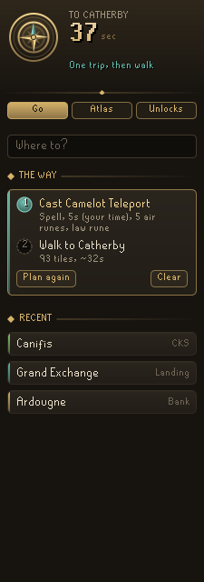
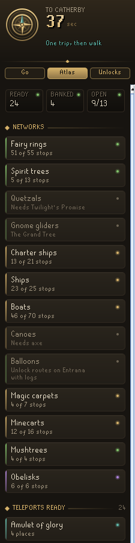
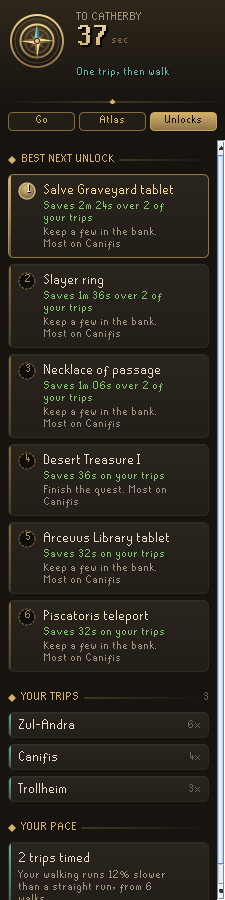
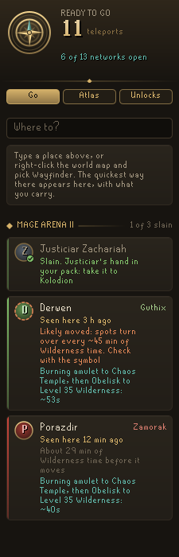

# Codex Wayfinder

The travel atlas of the **Codex** suite of RuneLite plugins. Type where you want to go and Wayfinder finds the fastest way there with what *this* account has: the teleports in your pack, the fairy rings and spirit trees you have opened, the boats and carpets you can afford. It times your own trips as you play, so its answers get closer to your real pace, and it tells you which unlock would save you the most time on the trips you actually make.

  

## Go
- **Where to?** Search towns, banks, altars, anvils, dungeons, minigames, agility courses, runecrafting altars and every fairy ring by name or by code (`cks` finds Canifis).
- **The way**: the route in plain steps, such as *Walk to the fairy ring*, then *Fairy ring CKS to Canifis*, with the time for each and the runes or fare it takes.
- **From your bank**: with *Plan with your bank* on, Wayfinder also shows the faster way if you fetch a teleport from the bank first, and marks the step that needs it.
- **Recent**: the last places you went, one click to plan again.
- Right-click the world map and choose **Wayfinder: Plan a route here** to go anywhere.

## In the game
- A **step plaque** shows the one thing to do next and the time left, and says whose time it is: *1m 40s at your pace* when every part is timed from your own trips, *~1m 40s, partly your pace* when some is, and *~1m 40s* for a plain estimate. A thin bar fills as you go.
- **The path on the ground**: a gilt ribbon from your feet along the planned tiles to where the next ride is boarded, with the ride named above that spot (*Fairy ring CKS to Canifis*), or to the place itself, outlined in gold.
- **The path on the minimap**: dots along the walk ahead, fainter dots for the walks after the next ride, a diamond where you board it. When that stop is past the minimap's edge, a dart on the rim points to it with the tiles left.
- **The path on the world map**: every walk as a gold line, every ride as a dashed teal leap named by its ring code or teleport, and a Wayfinder pin on the place (it sits at the map's edge when the place is off the map; click it to jump there).
- The tile to board (a fairy ring, a spirit tree, a ship's gangplank) is outlined.
- The route replans as you go, and a chat line says when you have arrived and how long it took; the path and pin clear themselves on arrival. Right-click the world map and choose **Wayfinder: Clear route** to drop it sooner.
- Each of these has its own switch under *In game*, and the path has its own colour.

## Mage Arena II
While Mage Arena II is in progress, the Go tab keeps a card for each of Kolodion's three god followers, and the world map pins each one where you last saw it.

- **Where you saw it**: when Justiciar Zachariah, Derwen or Porazdir rises and fights you, Wayfinder remembers the spot for this account, with *seen here 12 min ago*.
- **Whether the spot still holds**: the followers' spots turn over about every 45 minutes of your own Wilderness time, so Wayfinder counts the Wilderness time since and says when a spot has likely moved.
- **Which are slain**: a follower you kill, or whose component (Justiciar's hand, ent's roots, demon's heart) is in your pack or already with Kolodion, is marked slain. Dying undoes anything not yet handed in, as it does in the game.
- **The quickest way there**: each card names the teleports and obelisks of the quickest route from where you stand, with its time; click it to follow the route.
- Both parts have a switch under *Mage Arena II*. Nothing here helps in the fight itself, and Wilderness safety is left to Codex Guardian.

## Atlas
Everything you can travel with, at a glance: teleports ready in your pack, teleports in your bank, and every network (fairy rings, spirit trees, quetzals, gnome gliders, charter ships, ships, boats, canoes, balloons, carpets, minecarts, mushtrees and obelisks) with how many stops are open and what the rest need.

## Unlocks
Wayfinder remembers the journeys you make and asks what would make them shorter. Each suggestion says how much time it saves over your own trips: a network to open, a quest to finish, a level a few points away, a staff to carry, or a tablet to keep in the bank. Below it, your most-made trips and how your walking pace compares to a straight run.

## Times from your own trips
Every teleport, ring or ride you take is timed from the click to the landing and kept per account. Interrupted trips are thrown out. Learned times replace the estimates and are marked *your time*.

## For other Codex apps
Wayfinder shares what it knows so other apps can price travel without their own copy of the tables:

- **`codexwayfinder.atlasV1`** in the RuneLite profile (read-only for everyone else): the teleports this account can use with what it owns (landing tile, seconds, whether carried, whether timed), which networks are open, and the player's walking pace.
- **Plugin messages** on namespace `codexwayfinder`:
  - `route` with `x`, `y`, optional `plane`, `name` and `id` gets a `routed` reply with `id`, `found`, `seconds` and the steps in words.
  - `show` with the same fields opens the route in the Wayfinder panel.

## What it does not do
Wayfinder only advises. It never clicks, never moves the camera, never changes menu entries, and sends nothing off your computer. Everything it learns stays in your RuneLite profile.

## Field notes
An optional setting, **Keep field notes** (under Field notes, off by default), writes a plain record of what Wayfinder reads and decides to its own folder in `.runelite/plugin-data`. It is for checking the plugin's guesses against real play. Other players' chat is never written down, and nothing is sent anywhere.

## Credits
The travel tables and collision map come from the [Shortest Path](https://github.com/Skretzo/shortest-path) plugin, and the dungeon, minigame and course markers from RuneLite's World Map plugin. Both are BSD 2-Clause; see [THIRD-PARTY-NOTICES.md](THIRD-PARTY-NOTICES.md).

## Licence
BSD 2-Clause.
